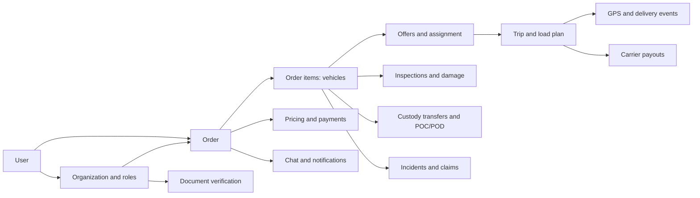
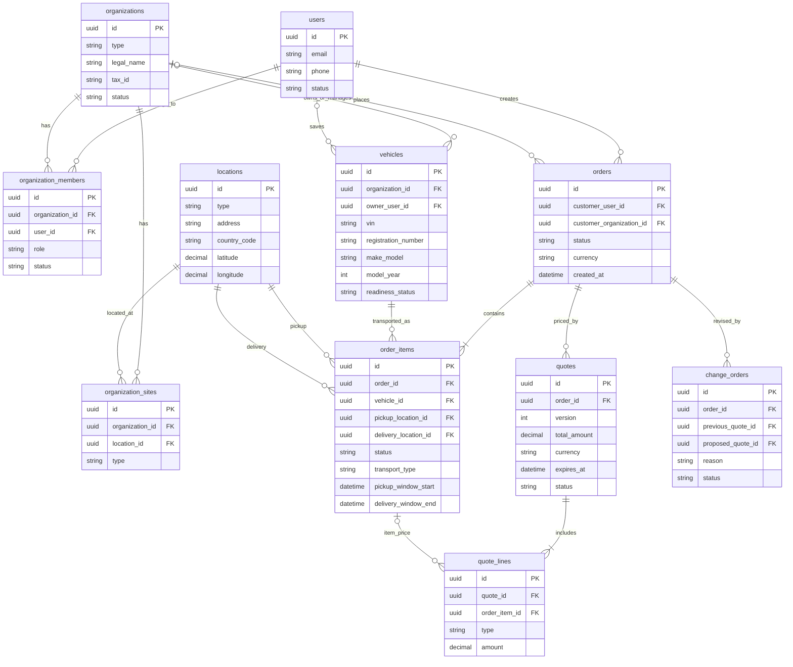
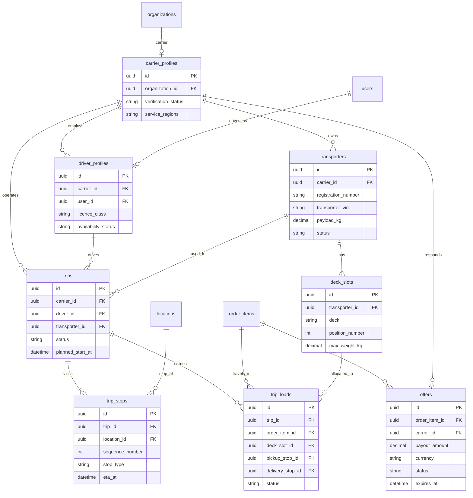
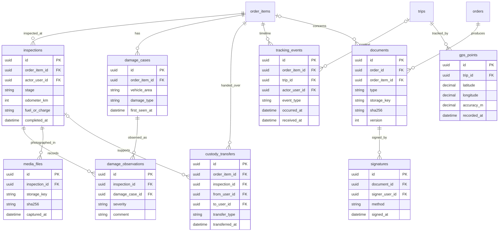

# Vehora — Database Schema Proposal

This conceptual PostgreSQL schema for the vehicle transport platform is based on the [source functional specification](https://github.com/NothingData/CODOOR/blob/main/README.md) (version 1.0). It shows **proposed** tables, fields, and relationships. It is a data model proposal, not an existing database or a set of SQL migrations.

In the diagrams, `1:N` means one record to many records, and `0..1` means an optional relationship. `PK` is a primary key; `FK` is a foreign key. Primary identifiers use `uuid`, money uses `numeric(18,2)` with a currency code, and timestamps use `timestamptz` in UTC.

## Node overview

The core chain is `orders → order_items → trip_loads → trips`. An order is the customer's commercial transaction; an order item is one vehicle and its delivery route; a trip is the carrier's physical journey. One order can therefore contain multiple vehicles, and a vehicle can travel on successive trips when it is transferred between carriers or vehicles.

## 1. Accounts, organizations, vehicles, and orders

`vehicles` stores the current vehicle record. Each `order_items` row also stores a **snapshot** of the VIN, specifications, declared value, technical questionnaire, and contacts at booking time. Later edits to the vehicle record must not rewrite order history. The same rule applies to addresses and time windows. For a private customer, `orders.customer_organization_id` is null; for a business customer, it is required.

| Node | Purpose and important additional fields |
| --- | --- |
| `organization_members` | Company membership and access rights; granular rights may use `roles`, `permissions`, and `role_permissions`. |
| `vehicles` | VIN, registration number, dimensions, weight, powertrain/EV type, stock or lot number, and transport readiness. |
| `order_items` | One vehicle to transport; a snapshot of its condition (`is_running`, keys, damage, equipment), declared value, and pickup/delivery windows. |
| `quotes` / `quote_lines` | Versioned price calculations and line items for transport, extras, protection, taxes, and discounts. The accepted version is attached to the order. |
| `change_orders` | A post-booking change: previous and proposed prices, customer approval, reason, author, and time. |

## 2. Carrier, marketplace, and trip

An `offers` row belongs to an order item; an accepted offer selects the carrier. `trip_loads` records the actual assignment. This supports multiple vehicles on one trip and a new row when a vehicle moves to another trip. An order item may have only one active load at a time. `trip_stops` defines the ordered stops, while `deck_slots` capacity and placement must be checked before the load plan is approved.

## 3. Inspection, GPS, documents, and chain of custody

Create an `inspections` row at pickup, delivery, and each handover. A completed inspection is immutable. A persistent `damage_cases.id` links observations of the same damage across inspections. `custody_transfers` stores the sender, receiver, time, location, keys, documents, and links to inspection evidence and signatures. POC, POD, and condition reports are `documents` types. Photos and PDFs live in object storage; PostgreSQL holds their metadata and `storage_key`.

`tracking_events` is an append-only status history; corrections create a new event. Offline clients need a unique `client_event_id`, `occurred_at`, and `received_at` so repeated synchronization does not create duplicates. GPS data belongs to an active trip; the associated order and the viewer's role control access.

## 4. Payments, communication, risk, and configuration

```mermaid
erDiagram
    orders ||--o{ payments : paid_by
    payments ||--o{ refunds : refunded_by
    trips ||--o{ payouts : settled_by
    carrier_profiles ||--o{ payouts : receives
    orders ||--o{ invoices : invoiced_by
    organizations o|--o{ invoices : billed_to
    orders ||--o{ conversations : discussed_in
    conversations ||--o{ messages : contains
    users ||--o{ notifications : receives
    order_items o|--o{ incidents : affects
    trips o|--o{ incidents : occurs_on
    incidents o|--o{ claims : may_open
    order_items ||--o{ claims : claimed_for
    organizations ||--o{ compliance_documents : verified_with
    driver_profiles o|--o{ compliance_documents : verified_with
    transporters o|--o{ compliance_documents : verified_with
    organizations ||--o{ tenant_configs : configures
    users ||--o{ audit_log : acts

    payments {
        uuid id PK
        uuid order_id FK
        string provider_reference
        decimal amount
        string currency
        string status
    }
    refunds {
        uuid id PK
        uuid payment_id FK
        decimal amount
        string status
    }
    payouts {
        uuid id PK
        uuid trip_id FK
        uuid carrier_id FK
        decimal amount
        string currency
        string status
    }
    invoices {
        uuid id PK
        uuid order_id FK
        uuid organization_id FK
        string invoice_number
        decimal total_amount
    }
    conversations {
        uuid id PK
        uuid order_id FK
        string type
    }
    messages {
        uuid id PK
        uuid conversation_id FK
        uuid sender_user_id FK
        string body
        datetime sent_at
    }
    notifications {
        uuid id PK
        uuid user_id FK
        string channel
        string status
    }
    incidents {
        uuid id PK
        uuid order_item_id FK
        uuid trip_id FK
        string category
        string status
    }
    claims {
        uuid id PK
        uuid order_item_id FK
        uuid incident_id FK
        string status
        decimal requested_amount
    }
    compliance_documents {
        uuid id PK
        uuid organization_id FK
        uuid driver_id FK
        uuid transporter_id FK
        string document_type
        string document_number
        string storage_key
        datetime expires_at
        string review_status
    }
    tenant_configs {
        uuid id PK
        uuid organization_id FK
        string config_type
        int version
        datetime effective_at
    }
    audit_log {
        uuid id PK
        uuid actor_user_id FK
        string entity_type
        uuid entity_id
        string action
        datetime created_at
    }
```

A `payments` row stores the payment provider reference and transaction status; Vehora does not store card details. A refund references its original payment, while a payout references the trip and carrier. If settlement must be broken down per vehicle, add `payout_lines` with `trip_load_id` and amount. `compliance_documents` supports an organization, driver, or transporter owner, as well as the document number, issuer, expiration, file, and reviewer. `tenant_configs` versions tariffs, SLAs, White Label settings, and rules; each calculated offer should retain the published rule version used for its price.

## Data integrity and access rules

1. **Tenant isolation.** Business data carries `organization_id`, and access is checked through `organization_members`. A private customer's order is visible only to its participants and authorized Vehora staff. White Label tenants use the same isolation model.
2. **Foreign keys.** An order item requires an order and vehicle; a load requires a trip and order item; a damage observation requires an inspection. Historical records should not be cascade-deleted; close or archive them instead.
3. **Status history.** Store the current order, trip, and payout status for fast reads. Also record every transition in `tracking_events` or a dedicated history table with its actor and reason.
4. **Uniqueness.** Normalize `vehicles.vin`; define VIN uniqueness with multi-organization imports in mind. Also enforce unique `(organization_id, user_id)`, `(trip_id, sequence_number)`, `(transporter_id, deck, position_number)`, and offline `client_event_id` values.
5. **Evidence.** Inspections, signed documents, custody transfers, financial transactions, and audit records retain their versions and do not overwrite earlier entries. Media records retain a hash and server timestamp.
6. **Privacy.** Precise GPS coordinates and documents are available according to role and the active transport period. Set retention periods for GPS, messages, and personal data, with separate support for a `legal_hold`.
7. **Performance.** Index all foreign keys, `orders(status, created_at)`, `order_items(vehicle_id, status)`, `tracking_events(order_item_id, occurred_at)`, `gps_points(trip_id, recorded_at)`, and compliance document expiration. Large GPS, event, and audit tables can be partitioned by time.
8. **Ownership.** A vehicle belongs to a private user or an organization. A compliance document belongs to exactly one organization, driver, or transporter. An incident can concern an entire trip, one order item, or both.

## Implementation phases

**MVP:** accounts, carrier organization, vehicles, orders and items, pricing and payment, offers, trips, drivers and transporters, inspections and damage, POC/POD, GPS and timeline, chat, notifications, Change Orders, compliance, payouts, and audit.

**Later phases:** dealer branches and bulk import, detailed multi-vehicle load planning, claims and returns, subscriptions, White Label, advanced rules, AI, and anti-fraud. The diagrams show the target model; later-phase tables can be introduced as the product expands.
